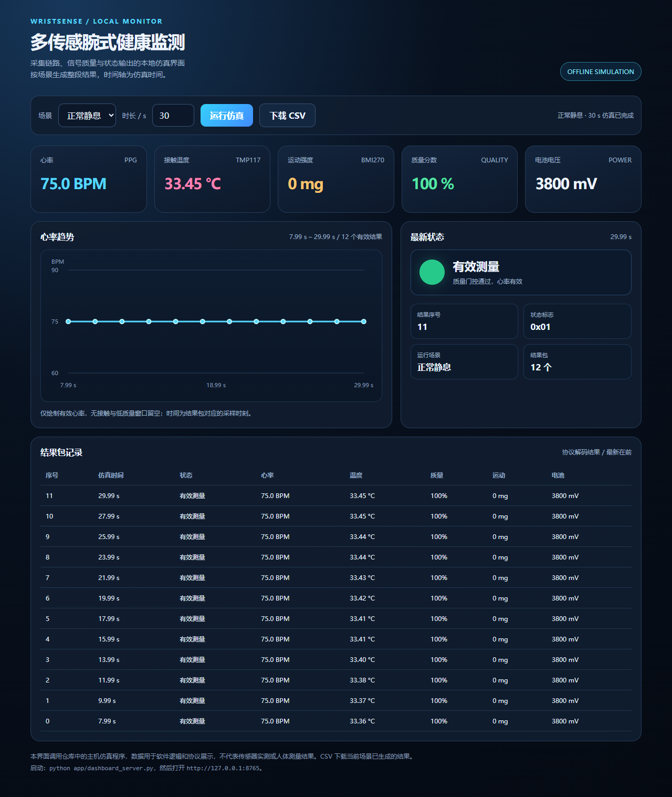

# 多传感腕式健康监测系统

《现代传感技术》课程设计的配套软件：MAX30102双通道PPG、BMI270三轴加速度、TMP117接触温度及nRF52840平台接口。可在没有开发板的电脑上运行C17核心、确定性仿真和浏览器仪表盘。

## 快速启动

需要Python 3.9或更高版本，以及支持C17的GCC。运行时只使用Python标准库和浏览器原生功能，不需要云服务、CDN或前端构建工具。

Windows PowerShell，在仓库目录运行：

```powershell
powershell -NoProfile -ExecutionPolicy Bypass -File .\start.ps1
```

脚本会编译仿真程序并启动本地网页服务，然后在浏览器打开 **http://127.0.0.1:8765**。保持终端运行，按Ctrl+C结束服务。若GCC或Python不在默认位置，可指定：

```powershell
.\start.ps1 -Compiler 'C:/MinGW/bin/gcc.exe' -Python 'C:/Python312/python.exe'
```

已安装GNU Make的Windows、Linux或macOS：

```sh
make test
make dashboard
```

可使用 `make PYTHON=python3 dashboard` 指定解释器。

## 网页显示什么

- 选择正常静息、运动干扰或无接触场景，生成8～60秒的仿真记录。
- 心率、接触温度、运动强度、质量分数及电池电压来自C程序输出，经过CSV和JSON传入页面。
- 心率趋势、状态和结果包表格共同显示有效性；无效心率显示为 `--`，对应曲线断开。
- 导出当前运行结果为CSV，便于保存和重新分析。

界面采用离线批量仿真：每次点击后计算所选时长的记录，再显示结果。仿真时长不等于等待时间，当前尚未连接实物传感器或BLE实时数据流。图表及数值用于软件逻辑验证，不能作为人体测量或临床性能证据。



## 信号处理与采样

PPG及加速度采样率为100 Hz，接触温度为1 Hz；有效心率需要完整8秒窗口，此后每2秒更新。光学信号去趋势、加Hann窗，以Goertzel计算0.5～4 Hz频带，并进行峰值插值。两个光学通道独立评价频谱集中度与强度；可信通道之间检查频率一致性，单通道退化时降低置信度后回退。三轴运动量参与质量门控。

离肤、传感器故障、充电、采样时间中断或回退会中止有效心率输出并重建窗口。整窗时间跨度还需符合100 Hz时间基准，避免把采样率漂移解释为心率变化。故障与离肤可以提前发送状态包；恢复后的有效心率仍需重新积累完整窗口。

质量评分与阈值是可解释的工程初值，尚未经过佩戴数据标定。合成信号的精度测试仅验证算法和回归行为。

## 目录

| 路径 | 内容 |
|---|---|
| `include/`、`src/` | 固定容量缓存、估计器、状态机、传感器驱动、采样控制与结果协议 |
| `app/simulator.c` | 确定性多场景输入及结果包CSV输出 |
| `app/dashboard_server.py`、`app/dashboard.html` | Python本地服务和浏览器界面 |
| `tests/` | C核心、信号反例、采样恢复、接口和浏览器回归 |
| `vendor/bosch/` | BMI270厂商配置数据及许可证 |
| `platform/nrf52840/` | 具体开发板的适配要求 |
| `docs/` | 架构、协议和验证范围 |

## 验证与命令行

```sh
make test
make simulator
build/whm_simulator.exe --seconds 30 --mode motion
```

Windows可使用 `mingw32-make`。Linux和macOS的可执行文件无 `.exe` 后缀。`make test` 会运行三组C测试及Python仪表盘接口测试；浏览器测试的运行方式见 [验证说明](docs/validation.md)。

## 硬件接口

`whm_hal_t` 将I²C、延时、单调时钟和BLE发送与算法隔离。BMI270加速度接口统一为mg，结果包保持22字节、小端序和CRC16-CCITT。接入开发板时须补齐引脚、TWIM、FIFO服务、硬件时间戳、BLE通知及电源配置，并完成实际硬件验证，详见 [平台说明](platform/nrf52840/README.md)。
